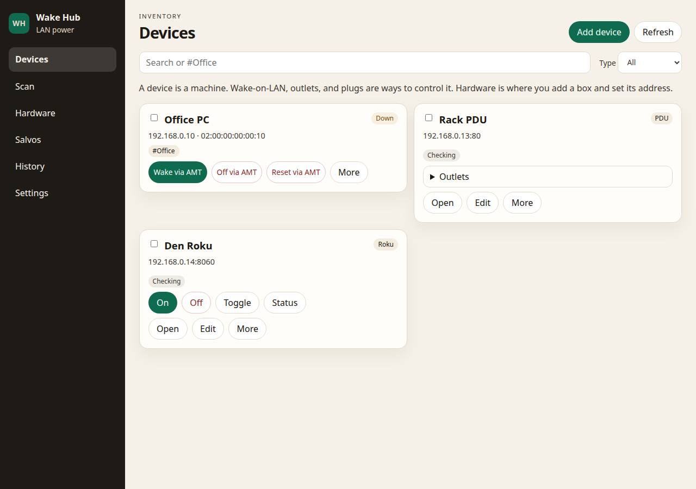
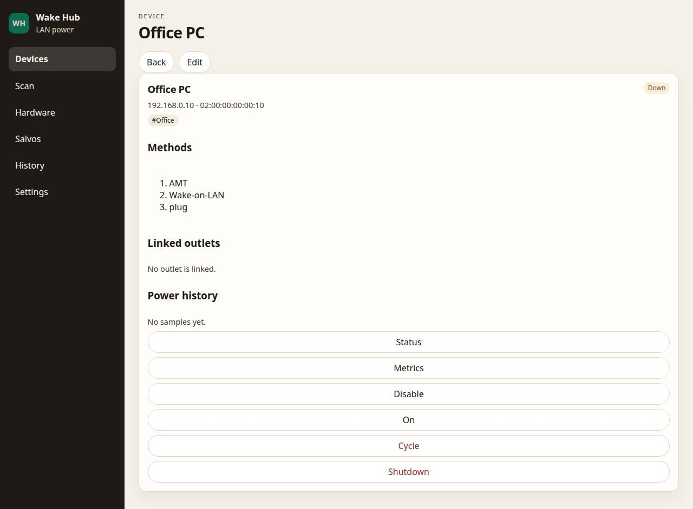
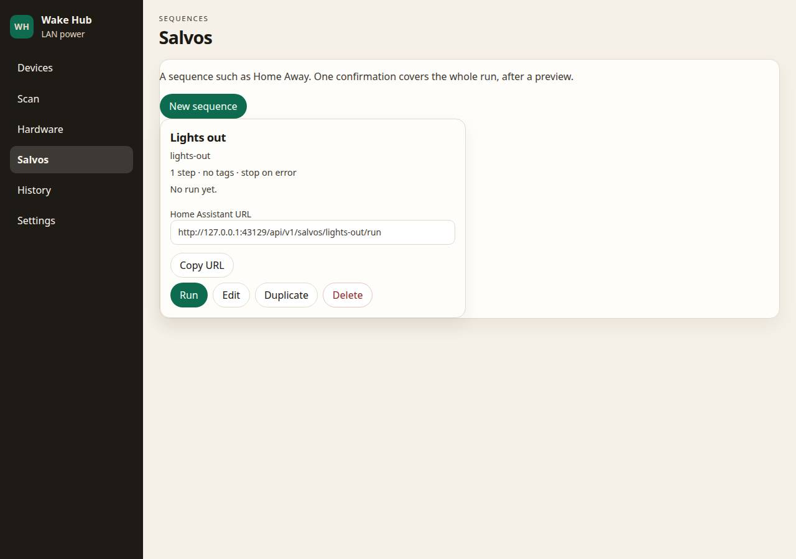

# Wake Hub

Self-hosted power control for a home LAN. One process serves a web UI, a versioned REST API and an MCP server, all on the same port. It can wake a machine, switch a Synaccess outlet or a smart plug, drive Intel AMT and JetKVM power buttons, and read or command a CyberPower UPS card.

The web UI requires a password. The API token is entered once, during first-run setup, and is then kept in an httpOnly cookie for 30 days (change the length in Settings). Signing out or rotating the token ends those sessions. The API and MCP always require a bearer token. Stored passwords are encrypted and are never returned.







## Run with Docker

Host networking is required. A bridge network does not deliver directed broadcasts, and ARP discovery cannot see the LAN from a bridge.

```bash
mkdir -p /mnt/user/appdata/wake-hub/config /mnt/user/appdata/wake-hub/data
docker compose up -d --build
```

On a machine that is not Unraid, create those directories or change the bind mounts. The UI is at `http://<host>:8765/`. The first start writes an API token and, if `WAKEHUB_SECRET_KEY` is unset, an encryption key at `/config/secret.key`.

`PUID` and `PGID` own the volume files. Unraid should use `99` and `100`. `NET_RAW` lets the unprivileged process send ICMP probes. A device can instead be probed on a TCP port, which does not need that capability.

| Variable | Default | Purpose |
| --- | --- | --- |
| `PORT` | `8765` | Web UI, REST and MCP. Life-Dashboard's MCP also uses 8765; when both run on one host, set `PORT=8766` and map that port |
| `PUID` / `PGID` | `99` / `100` | Volume owner |
| `WAKEHUB_SECRET_KEY` | generated file | Encrypts the API token and device passwords |
| `WAKEHUB_CORS` | empty | Browser origins allowed to call the API. Empty blocks cross-origin calls |

Config lives in `/config`. SQLite lives in `/data`.

### Unraid

**Compose Manager.** Use `docker-compose.yml` as a stack. Keep `network_mode: host`. Appdata is `/mnt/user/appdata/wake-hub/config` and `/mnt/user/appdata/wake-hub/data`.

**Community Applications.** The template is `unraid/wake-hub.xml`. Use the same appdata paths, host networking, and `NET_RAW`. The port variable is `8765`.

**Port clash.** `8765` is also the Life-Dashboard MCP port. When both run on one Unraid host, set `PORT=8766` and map that port instead of 8765.

**Update.** Pull `ghcr.io/davidmcferrin-spec/wake-hub:latest` and recreate the container. The database and key stay on the appdata share. Images are built for `linux/amd64` and `linux/arm64` by `.github/workflows/image.yml`. GitHub Container Registry packages are private by default. Either make the package public or run `docker login ghcr.io` on the Unraid host before the pull.

## What you can control

- **Inventory.** Name, MAC, host, broadcast, WOL port, optional SecureOn password, notes, tags, enabled flag, and one or more power methods. Disabled devices are listed but cannot be acted on. A MAC or host can belong to only one device, and a host can belong to only one PDU, AMT endpoint, JetKVM, plug, or UPS. A repeat is a conflict that names the existing record. Hosts and MACs are compared after normalizing case, whitespace, and IPv6 spelling. Rows that were already duplicated are left in place and listed in settings.
- **Wake-on-LAN.** Magic packet to a directed broadcast on port 9 or 7, then ICMP or a TCP port until the host answers or the timeout ends. `wake_strategy=power_then_wol` turns a linked plug or PDU outlet on before the packet.
- **Synaccess netBooter.** Add by IP and credentials. List outlets, switch one on, off or reboot. Outlet names are read when a PDU is added, when a scan adds it, and from Refresh names from device or Re-read from device on the PDU's edit page. A name set in Wake Hub is kept. The live status poll reads /status.xml (one request), and uses the status command only when that page is missing. Scan progress and the history log update from the same kind of background poll. History shows whether a command came from the UI, the API, or MCP. Names come from the outlet setup page. A netBooter name is limited to 16 characters. If the name pages cannot be read, the edit page says so, and Download PDU diagnostics saves those pages plus the status reply, with credentials removed. Outlet tags are edited on that page too. The NP-1601DU reports inlet bank current, not per-outlet current.
- **Intel AMT / vPro.** Digest auth on port 16992 or 16993. TLS can allow that device's self-signed certificate. Read power state through WS-Management. The same commands are used on a computer and on the AMT card: on is power-state 2, Off is 8 (a hard power off), Reset is 10, power cycle is 5, and Shutdown is 12 (a soft graceful off). There is no separate hard-off command. Turning on a machine that is already on, or off when it is already off, does nothing and reports that. Graceful shutdown is refused only when the firmware does not list power-state 12. Other commands are sent and the result comes back from AMT. The buttons stay usable; a status read can note that the firmware does not list one right now, and that note is cleared after a command or a failed read. If Auto wake cannot reach AMT, Wake-on-LAN is sent instead. Those buttons are on the AMT card in the Devices list, whether or not it is linked to a computer. Hardware is only where you set the address and login. If the status read fails, the buttons stay and the error is shown.
- **JetKVM.** Local password or no password. Reachability, ATX short press, long press, reset, DC on/off when that extension is present, and a console URL that opens in a new tab.
- **Shelly Plug US Gen4.** Gen2 RPC (`Switch.GetStatus`, `Switch.Set`, `Switch.Toggle`) with optional digest auth, plus power, voltage and energy when the plug reports them.
- **Kasa (EP10, EP25, KP125M and the same family).** Legacy XOR on port 9999, and KLAP on current firmware using the TP-Link account email and password. Energy is read on models that report it.
- **Salvos.** A named sequence such as Home Away or All Lights Off, on its own Salvos page (`#/salvos` and `#/salvos/<slug>`). Each step targets one computer, plug, or Roku, or a set of tags that must all match, with wake, on, off, cycle, or shutdown. A step can wait before it runs. The salvo stops on the first error, or keeps going. Run shows a preview of every device it will hit, then one confirmation covers the whole sequence. The page lists the name, slug, step count, tags, and the last run. Each slug shows the Home Assistant `rest_command` URL with a copy button. Each device is written to the history log. The slug, such as `home-away`, stays in the run URL when the name changes. A schedule column is stored and unused.
- **Roku.** Add by IP. External Control Protocol on port 8060: power on, off and toggle, and status from device-info (power mode, model, name). Discovery uses SSDP `roku:ecp` and the Roku MAC vendor. Test checks device-info without sending a key. Control by mobile apps must be enabled on the TV. Some models need network standby before they can power back on. Off and toggle ask for confirmation.
- **CyberPower RCCARD100.** SNMP v1, v2c or v3. Status, on line or on battery, capacity, runtime, input and output voltage, load, current and watts. Shutdown, reboot, turn off (immediate or delayed), battery test, and outlet-bank control. The UI warns before those commands.
- **Discovery.** The scan box is filled from this host's primary IPv4 subnet. A scan can replace earlier results for that same subnet or keep them. A past scan can be run again with the same subnet, deleted on its own, or cleared with confirmation. None of those remove inventory devices. Settings can keep the last N scans or drop scans older than a number of days; 0 leaves that limit off. Docker, veth and bridge interfaces are skipped, and a picker appears when more than one LAN remains. Ping, ARP and fingerprinting run together. Each host is grouped by a suggested type (AMT, Kasa, Shelly, JetKVM, Synaccess, CyberPower, Roku, or a generic PC) with a confidence and a one-click add. Hosts already in the inventory are marked.
- **A computer's page** shows Wake-on-LAN plus every linked PDU outlet, plug, AMT endpoint, JetKVM and UPS. The device list and each computer's page show live watts, current and energy, with a short chart, when a smart plug, PDU bank, UPS load, or JetKVM DC supply is linked. A card with no reading stays blank. The broadcast address is in the device's edit form, and hovering the address line shows it. Devices lists computers and every PDU, AMT endpoint, JetKVM, plug, UPS and Roku, with a type filter. Open a hardware row for its page. Computers and hardware take tags such as #Office and #Lights. A tag keeps the spelling from the first time it was saved, so a later #office is stored and matched as that same tag. The search box understands #tag, chips on the cards filter the list, and more than one tag means all of them. Wake tagged and Power off tagged ask you to confirm before they run. The Hardware page is where those records are added and edited, with one tab per kind. Each has its own username and password. A saved login and the linked computer are chosen from dropdowns, including None. Removing a saved login that is still in use is refused until you confirm, which clears those links. Changing or clearing the UI password signs every browser out. Test checks the settings without saving. A wake test sends the magic packet only after you confirm. Editing a record keeps you on that page, starts from the current values, and leaves the password blank until you type a new one.
- **Telemetry.** Bank current, plug power and energy, and UPS load and voltages are polled into SQLite. JetKVM DC voltage, current and watts are polled only when that endpoint is set to the DC extension and its metrics toggle is on, because a poll opens a WebRTC session and can take over an open console. The UI shows the latest values and a small chart. Retention and the poll interval are settings.

## REST API

OpenAPI: `/openapi.json`. Docs: `/docs`.

```
Authorization: Bearer <token>
```

A missing or wrong token is `401`. `off`, `cycle`, `reboot`, `shutdown`, outlet off, JetKVM force-off and reset, and the destructive UPS commands are `409` with code `confirmation_required` until the body sets `confirm` to true.

Deleting a scan, clearing scan history, re-scanning with replace, or pruning old scans removes only those scan rows. Devices and hardware stay.

`POST /api/v1/inventory/remove` deletes devices and hardware. `targets` is a list of `{kind, id}` and `tags` deletes every record that has all of those tags. `confirm: false` returns the names and the salvos that would lose a step, and deletes nothing. `confirm: true` deletes the records, unlinks plug and PDU outlet mappings, and drops salvo steps that named them. A single DELETE of a device, plug, PDU, AMT endpoint, JetKVM, UPS, or Roku does the same cleanup. Tag steps stay.

## MCP

Streamable HTTP at `/mcp`, same bearer token. Without the token the endpoint is `401`.

Tools: `list_devices`, `get_device`, `add_device`, `update_device`, `remove_device`, `bulk_remove`, `set_device_enabled`, `wake_device`, `power_action`, `device_status`, `list_status`, `list_actions`, `get_settings`, `update_settings`, `get_access_token`, `rotate_token`, `ui_login`, `ui_setup`, `ui_logout`, `get_ui_session`, `list_interfaces`, `test_target`, `list_credential_profiles`, `add_credential_profile`, `update_credential_profile`, `remove_credential_profile`, `list_pdus`, `add_pdu`, `update_pdu`, `remove_pdu`, `list_pdu_outlets`, `refresh_pdu_outlet_names`, `set_pdu_outlet`, `list_amt`, `add_amt`, `update_amt`, `remove_amt`, `amt_power_state`, `list_jetkvm`, `add_jetkvm`, `update_jetkvm`, `remove_jetkvm`, `jetkvm_status`, `jetkvm_power`, `jetkvm_console`, `list_plugs`, `add_plug`, `update_plug`, `remove_plug`, `plug_status`, `plug_power`, `list_ups`, `add_ups`, `update_ups`, `remove_ups`, `ups_status`, `ups_action`, `list_rokus`, `add_roku`, `update_roku`, `remove_roku`, `roku_status`, `roku_power`, `list_tags`, `tag_action`, `list_salvos`, `get_salvo`, `add_salvo`, `update_salvo`, `remove_salvo`, `duplicate_salvo`, `run_salvo`, `scan_subnet`, `list_scans`, `scan_results`, `delete_scan`, `clear_scans`, `rescan`, `add_from_scan`, `device_metrics`, `list_metrics`.

`tests/test_parity.py` fails if any of these is missing from the OpenAPI document, the MCP tool list, or a `data-cap` control in the UI.

## Integrating from another service

Life-Dashboard, or any other LAN service, should call the versioned REST API. Paths under `/api/v1` stay stable. A breaking change will move to `/api/v2`.

Base URL: `http://<unraid-host>:8765`

Auth: `Authorization: Bearer <token>`

The API token is printed in the container log and written to `/config/token` on startup. The web UI requires a password. On first run, enter that token plus a new password of at least 8 characters. After you sign in, Settings can show the token. `GET /api/v1/ui/session` does not return the token unless the browser already has a valid session cookie. Server-side callers should store the token themselves. Do not send PDU, AMT, JetKVM, plug or UPS passwords back out of Wake Hub; those endpoints never return them.

List devices:

```bash
curl -s \
  -H "Authorization: Bearer $WAKEHUB_TOKEN" \
  http://192.168.1.10:8765/api/v1/devices
```

Wake one device and wait until it answers, or until the device timeout:

```bash
curl -s -X POST \
  -H "Authorization: Bearer $WAKEHUB_TOKEN" \
  -H "Content-Type: application/json" \
  http://192.168.1.10:8765/api/v1/devices/1/wake
```

The response includes `sent`, `reachable` and `elapsed_s`. `reachable` is `null` when the device has no host to probe.

CORS defaults to empty, so a web page on another origin cannot call the API. Set `WAKEHUB_CORS`, or the settings page, to the origin of a browser app such as `http://192.168.1.10:8080`. Use `*` only when you intend to allow any origin. Server-side calls do not use CORS.

The same token works for MCP:

```
POST http://192.168.1.10:8765/mcp
Authorization: Bearer $WAKEHUB_TOKEN
```

Call `list_devices`, then `wake_device` with the `device_id`. To run a scene, call `list_salvos`, then `run_salvo` with that salvo's slug and `confirm=true`. `dry_run=true` lists the devices and changes nothing.

## Home Assistant

Home Assistant, or any other service, runs a salvo with one POST. The path uses the slug so the automation does not break when the numeric id changes. The body is JSON and needs `confirm`. The response `results` list is one entry per device.

Wake Hub has one API bearer token. It is not the UI password. The Settings page shows it, and the container writes it to `/config/token`. Put it in Home Assistant's `secrets.yaml` and reference it with `!secret`. Do not commit the token. There is no second token in this version. Rotating the token on the Settings page replaces the only one, so update the secret afterward.

`secrets.yaml`:

```yaml
wakehub_token: "paste-the-api-token"
wakehub_auth: "Bearer paste-the-api-token"
```

`configuration.yaml`:

```yaml
rest_command:
  wakehub_run_salvo:
    url: "http://192.168.1.10:8765/api/v1/salvos/{{ slug }}/run"
    method: POST
    content_type: application/json
    headers:
      Authorization: !secret wakehub_auth
    payload: '{"confirm": true}'
    timeout: 120
  wakehub_wake_device:
    url: "http://192.168.1.10:8765/api/v1/devices/{{ device_id }}/wake"
    method: POST
    headers:
      Authorization: !secret wakehub_auth
    timeout: 60
  wakehub_tag_action:
    url: "http://192.168.1.10:8765/api/v1/tags/action"
    method: POST
    content_type: application/json
    headers:
      Authorization: !secret wakehub_auth
    payload: '{"tags": ["{{ tag }}"], "action": "{{ action }}", "confirm": true}'
    timeout: 120

script:
  home_away:
    alias: Home Away
    sequence:
      - action: rest_command.wakehub_run_salvo
        data:
          slug: home-away
  wake_desk:
    alias: Wake Desk
    sequence:
      - action: rest_command.wakehub_wake_device
        data:
          device_id: 1
  lights_off:
    alias: Lights off
    sequence:
      - action: rest_command.wakehub_tag_action
        data:
          tag: Lights
          action: "off"
```

Home Assistant stops a `rest_command` after 10 seconds. A salvo waits out each step delay before it returns, and a wake waits until the computer answers, so `timeout` has to be longer than those waits added together. Raise it when a salvo's delays exceed two minutes.

Replace the host and the device id. `slug` is the value shown on the salvo card. `tag` is the tag without a leading `#`. `action` for a tag is `wake`, `on`, or `off`. A tag action requires every listed tag to match. The run response looks like `{"slug": "home-away", "results": [{"action": "off", "kind": "plug", "id": 3, "name": "Lamp", "ok": true, "detail": "salvo Home Away"}]}`.

An MCP client should call `list_salvos` to read the slugs, then `run_salvo` with that slug. Those two tool descriptions say when to use them, so a model can choose a salvo instead of powering devices one at a time.

## Development

```bash
python -m venv .venv
.venv/bin/pip install -e ".[dev]"
.venv/bin/pytest -q --tb=line
WAKEHUB_CONFIG_DIR=./config WAKEHUB_DATA_DIR=./data .venv/bin/python -m wakehub.main
```

`ping` (`iputils-ping`) is required for ICMP probes and for the discovery sweep.

## Not verified on hardware

CI and the local tests build magic packets and catch them with a UDP listener, parse recorded Synaccess, AMT, JetKVM, Shelly, Kasa and CyberPower fixtures, and scan `127.0.0.1/32`. They do not talk to a sleeping PC, an NP-1601DU, an AMT firmware, a JetKVM, a Shelly or Kasa plug, or an RCCARD100.

In particular, without those devices it is not confirmed that:

- a directed broadcast crosses the Unraid host's switch and that a NIC with SecureOn accepts the password bytes
- an NP-1601DU's live `$A5` string matches the bank-current layout used here (the parser follows Synaccess's published format)
- an AMT stack accepts the WS-Management body and digest challenge this client sends
- a JetKVM completes the WebRTC offer and answers `getATXState` / `setATXPowerAction` / `setDCPowerState` (the JSON-RPC and signaling bytes are covered by fixtures; the live data channel is not). DC volts, amps and watts are collected only after the endpoint is set to the DC extension and metrics polling is turned on for that device. A poll opens a WebRTC session, which can take the console away from someone who already has it open. That takeover was not checked on hardware
- the suggested type for a live Intel, TP-Link, Shelly, JetKVM, Synaccess or CyberPower device matches what is on the bench (the rules are covered by fixtures; no device was scanned)
- mDNS answers for `_shelly._tcp` and `_jetkvm._tcp` were not heard on a real LAN
- a current Kasa firmware accepts this KLAP handshake (the hash and AES framing are covered by test vectors; no plug was attached)
- an RCCARD100 reports runtime as TimeTicks and accepts the graceful-delay SET (the client follows the CPS-MIB; the card was not queried)
- SNMP v3 auth and privacy on that card match the protocols selected in the form
